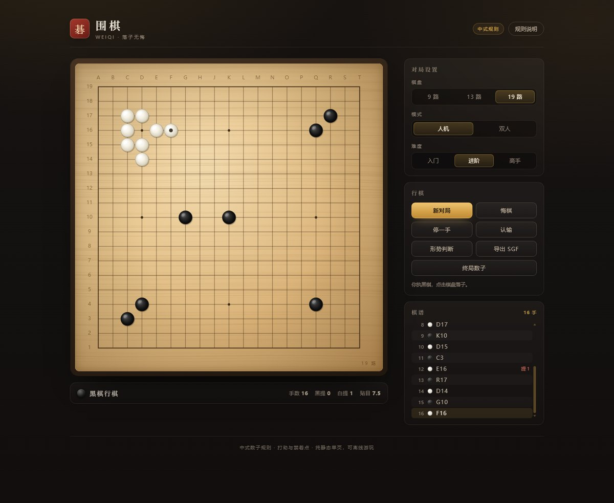

# 围棋 · Weiqi

一个精致、零依赖、纯静态的在线围棋。打开即玩，支持人机对弈与双人对局，包含提子、打劫、禁着点、终局数子与 SGF 导出。



## 特性

- **三种棋盘**：9 路 / 13 路 / 19 路，切换即开新局，贴目自动匹配（19 路 7.5，13/9 路 5.5）
- **完整规则判定**：气与提子、自杀禁着、简单劫（禁止立即回提还原局面）、连续停一手终局
- **人机对弈**：三档难度的启发式 AI（提子 / 救棋 / 打吃 / 避免自紧气 / 不填自家眼 / 边线偏好），双人模式可同屏对弈
- **终局数子**：中式数子法（子 + 空 + 贴目），可在棋盘上点选死子实时修正结果；也支持随时「终局数子」
- **对局辅助**：悔棋、停一手、认输、形势判断（目数标记）、SGF 棋谱导出
- **自适应界面**：桌面双栏、移动端单栏，Canvas 高清渲染（木纹底、棋子渐变、落子与提子动画、最后一手标记）
- **纯静态**：无构建步骤、无第三方依赖，可离线打开 `index.html` 直接游玩

## 本地运行

直接双击 `index.html` 即可（脚本为普通 script，不依赖模块服务器）。

如需本地服务器：

```bash
python -m http.server 8000
# 或
npx serve .
```

然后访问 <http://localhost:8000>。

## 测试

```bash
node test/engine.test.js
```

覆盖提子、自杀、打劫、数子、死子标记、悔棋、停一手、SGF 与 AI 落子合法性。

## 部署到 GitHub Pages

### 方式一：网页上传（无需命令行）

1. 打开 <https://github.com/new>，仓库名填 `weiqi`，选择 **Public**，不要勾选初始化 README，创建。
2. 在仓库页点 **Add file → Upload files**，把本目录下的 `index.html`、`assets/`、`preview.jpg`、`README.md`、`LICENSE`、`package.json` 拖进去，提交。
3. 由于网页上传可能忽略点开头的隐藏文件，请再点 **Add file → Create new file**，文件名填 `.nojekyll`（内容留空）并提交 —— 它让 GitHub Pages 跳过 Jekyll 处理。
4. 进入 **Settings → Pages**，Source 选 **Deploy from a branch**，分支 `main`、目录 `/ (root)`，保存。
5. 等待 1–2 分钟，访问 `https://<你的用户名>.github.io/weiqi/`。

### 方式二：Git 推送

```bash
cd weiqi
git init -b main
git add .
git commit -m "feat: 围棋在线对弈"
git remote add origin https://github.com/<用户名>/weiqi.git
git push -u origin main
```

然后在 **Settings → Pages** 里选择 `main` 分支根目录。

> 注意：`.nojekyll` 是隐藏文件，`git add .` 会一并提交；如果手动挑选文件上传，别忘了它。

### 方式三：API 脚本（可选）

仓库内附带了只依赖 Node 18+ 的部署脚本，可在 `github.com` 打不开、但 `api.github.com` 可用的网络下完成建仓、提交与开启 Pages：

```bash
GITHUB_TOKEN=ghp_xxx node scripts/deploy.mjs
```

Token 需要 `repo`（经典令牌）或 `Contents / Pages / Administration` 写权限（细粒度令牌）。

## 目录结构

```
weiqi/
├── index.html              页面结构
├── preview.jpg             README 预览图
├── assets/
│   ├── css/style.css       视觉样式
│   └── js/
│       ├── engine.js       规则引擎（气、提子、劫、数子、SGF）
│       ├── ai.js           启发式 AI
│       ├── board.js        Canvas 棋盘渲染与动画
│       └── app.js          界面联动与对局流程
├── scripts/deploy.mjs      GitHub Pages 部署脚本（可选）
├── test/engine.test.js     规则引擎测试
├── package.json            脚本入口（test / start / deploy）
├── LICENSE                 MIT 许可
└── .nojekyll               跳过 Jekyll 处理，保证静态资源原样发布
```

## 规则与实现说明

- 采用**中式数子法**：黑 = 黑子数 + 黑空；白 = 白子数 + 白空 + 贴目。终局不自动判定死活，需要手动点选死子（这是刻意设计，避免误判）。
- 打劫采用**简单劫**：禁止新着法还原到上一手之前的全局局面；未实现三劫循环 / 全局同形（超级劫）。
- AI 为启发式评估（非神经网络），擅长局部提子与联络，棋力约在入门到业余低段之间，适合休闲对弈。
- 所有数据仅保存在浏览器 `localStorage`（棋盘、模式、难度偏好），不上传服务器。

## 许可

[MIT](LICENSE)
